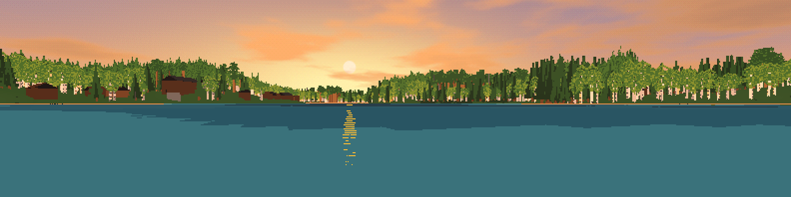
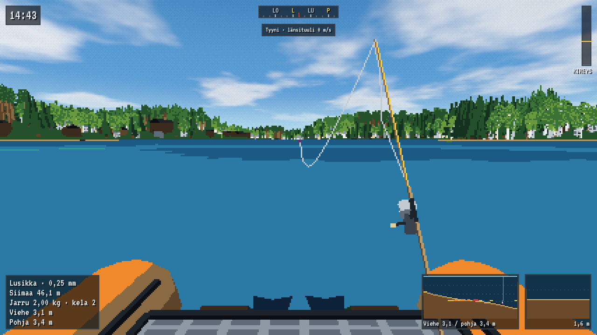
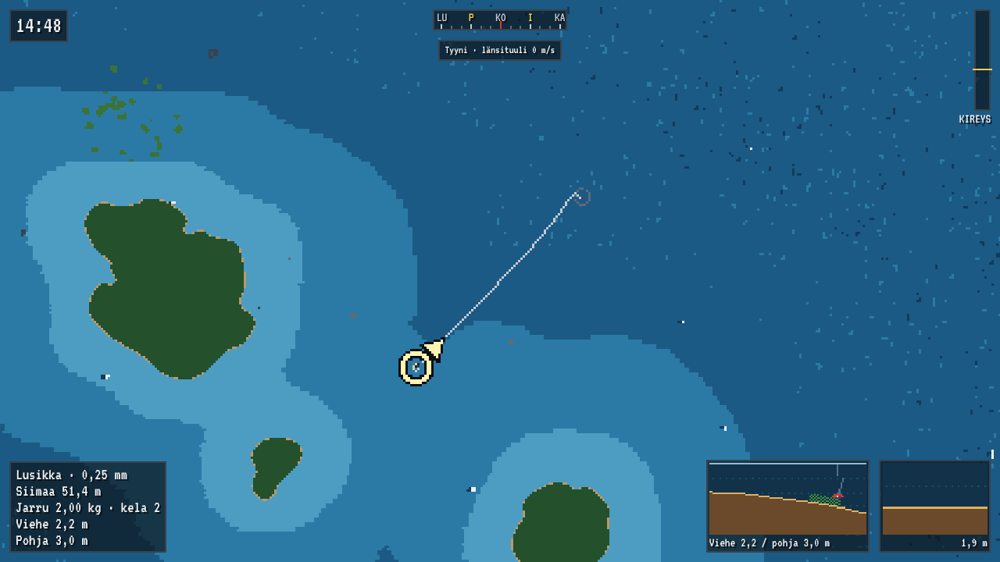
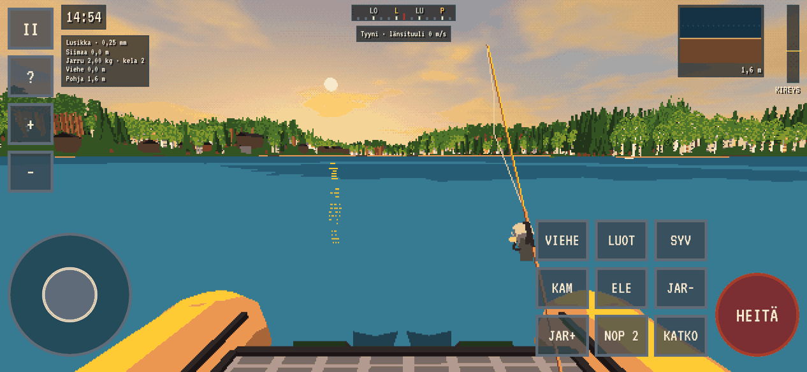

# Lunkinjärvi



Moninpeli, jossa kalastetaan kelluntarenkaalta Tammelan Lunkinjärvellä.
Selainpeli, retrografiikka, ajastettu kilpailu ja yllättävät säät.

Pelaa: <https://lunkinjarvi.com/>

- Yksinpeli tai moninpeli kavereiden kanssa jaetulla koodilla, ilman
  kirjautumista. Kisan pituus, voittoehto, sää ja rangaistukset valitaan
  ennen kisaa. Yksinpelin oletus on aikarajaton sessio, joka kestää, kunnes
  pelaaja lopettaa ja punnitsee saaliin.
- Järvi, rannat ja ympäristö avoimesta kartta-aineistosta.
- Virveli ja perho, 11 kalalajia, siimojen sotkeutuminen, pohjaan tarttuvat
  vieheet ja hampaiden katkaisemat siimat.
- Säätasot tyynestä täyteen kaaokseen: ukkonen, salamat, kaatavat aallot ja
  trombit.
- Kuvakulma ylhäältä tai kalastajan silmin, ohjaus näppäimistöllä ja hiirellä
  tai puhelimen kosketusnapeilla. Suomeksi ja englanniksi.
- Toimii millä tahansa selaimella. Yksinpeli toimii myös ilman nettiä ja
  ilman pelipalvelinta; vain moninpeli tarvitsee palvelimen.

| Kalastajan silmin                                                                    | Ylhäältä                                                        |
| ------------------------------------------------------------------------------------ | --------------------------------------------------------------- |
|  |  |



Kehitys etenee GitHub Issueiden kautta: jokainen muutos omassa haarassaan ja
PR:ssä, ja main päivittyy vain yhdistettyjen PR:ien kautta. Työtapa,
issueiden tunnisteet ja pelin yhtenäiset järjestelmät, joita jokainen
muutos noudattaa: [docs/kehitys.md](docs/kehitys.md).

## Ajaminen paikallisesti

Tarvitset [Node.js 22](https://nodejs.org/) tai uudemman ja pnpm:n
(`corepack enable` asentaa oikean version automaattisesti).

```sh
pnpm install
pnpm dev          # avaa pelin selaimessa (http://localhost:5173)
```

Moninpeli paikallisesti: käynnistä lisäksi pelipalvelin toisessa
terminaalissa (`pnpm dev:server`, portti 2567). Peli ottaa yhteyden samaan
koneeseen porttiin 2567; toisen palvelimen voi antaa osoitteella
`?palvelin=wss://…` tai koontiaikana muuttujalla `VITE_LUNKI_SERVER`.
Valikosta "Moninpeli" luodaan huone, ja kaverit liittyvät koodilla
(esim. `LUNKI-4F7K`) tai kutsulinkillä.

## Dokumentaatio

| Ohje                                              | Sisältö                                                                |
| ------------------------------------------------- | ---------------------------------------------------------------------- |
| [kehitys.md](docs/kehitys.md)                     | Työtapa, issueiden tunnisteet ja yhtenäiset järjestelmät               |
| [julkaisu.md](docs/julkaisu.md)                   | GitHub Pages, palvelin Cloudflare Tunnelin takana, service worker, SEO |
| [windows-palvelin.md](docs/windows-palvelin.md)   | Palvelin pelikoneelle, etäkäynnistys SSH:lla, palautteet issueiksi     |
| [pilvipalvelin.md](docs/pilvipalvelin.md)         | Valmius Hetznerin pilvikoneelle: kontti, päivitys, kone päälle ja pois |
| [lan.md](docs/lan.md)                             | LAN-peli ilman nettiä: läppäri palvelimeksi                            |
| [moninpeli.md](docs/moninpeli.md)                 | Verkkokoodi: ennakointi, kisan kulku, katkokset, sotkut, eleet         |
| [kalalajit.md](docs/kalalajit.md)                 | Kalalajit, käyttäytyminen, vieheet, varusteet ja perhokalastus         |
| [pohja.md](docs/pohja.md)                         | Järven pohja ja erikoismuodot                                          |
| [saa.md](docs/saa.md)                             | Sää, säätasot, salamat, aallot ja trombit                              |
| [puheaanet.md](docs/puheaanet.md)                 | Kalastajan puheäänet ja niiden teko                                    |
| [suorituskyky.md](docs/suorituskyky.md)           | Suorituskykymittaus (`?bench=1`) ja kevennykset                        |
| [kansikuvat/README.md](docs/kansikuvat/README.md) | LinkedIn-kansikuvat ja niiden renderöinti                              |

Pelipalvelin pyörii Luukan pelikoneella osoitteessa
`wss://peli.lunkinjarvi.com` (Cloudflare Tunnel), ja pelisivu on GitHub
Pagesissa. Pelikone on usein kiinni, joten peli ei saa vaatia palvelinta
muuhun kuin moninpeliin.

Muut komennot:

| Komento           | Mitä tekee                                        |
| ----------------- | ------------------------------------------------- |
| `pnpm dev`        | Asiakkaan kehityspalvelin (Vite)                  |
| `pnpm dev:server` | Pelipalvelin kehitystilassa                       |
| `pnpm run server` | Pelipalvelin pelikäyttöön (portti 2567)           |
| `pnpm lan`        | LAN-peli: palvelin ja pelisivu samasta koneesta   |
| `pnpm report`     | Palvelimen tietokannan palautteet ja virheet      |
| `pnpm test`       | Kaikkien pakettien testit (Vitest)                |
| `pnpm e2e`        | Selaintestit (Playwright, aja `pnpm build` ensin) |
| `pnpm lint`       | ESLint                                            |
| `pnpm typecheck`  | TypeScript-tarkistus kaikille paketeille          |
| `pnpm format`     | Muotoilee koodin Prettierillä                     |
| `pnpm check`      | Lint, muotoilu, tyypitys ja testit kerralla       |
| `pnpm build`      | Tuotantobuild (asiakas `packages/client/dist`)    |

## Rakenne

```
packages/
  client/        Selainpeli (Vite + Three.js)
  server/        Pelipalvelin (Colyseus) ja ennätykset (SQLite)
  shared/        Jaettu koodi: fysiikka, sää, kalat, pelisäännöt, tyypit
  map-pipeline/  Lunkinjärven kartta avoimesta aineistosta pelin muotoon
e2e/             Selaintestit (Playwright)
scripts/         Pelikoneen ja Macin apukomennot, kuvakkeet, puheäänet, kansikuvat
docs/            Ohjeet, ks. yllä
```

Pelin fysiikka ja säännöt ovat `shared`-paketissa, jotta asiakas ja palvelin
laskevat ne samalla koodilla.

Peli on suomeksi ja englanniksi (päävalikon kielivalitsin). Pelaajan näkemät
tekstit ovat sanakirjoissa `packages/client/src/i18n/` (`fi.ts` on lähdekieli,
`en.ts`:stä puuttuva avain on käännösvirhe). Palvelin lähettää virheet koodeina,
ja kukin selain kääntää ne pelaajan kielelle.

## Kartta-aineisto

- Rantaviiva ja ympäristö (metsät, pellot, tiet, rakennukset):
  © [OpenStreetMapin tekijät](https://www.openstreetmap.org/copyright), ODbL 1.0.
- Maaston korkeus: Copernicus DEM GLO-30, © DLR e.V. 2010–2014 ja © Airbus Defence and
  Space GmbH 2014–2018, Copernicus-ohjelma (EU, ESA).
- Järven perustiedot (pinta-ala, korkeustaso): Suomen ympäristökeskus (Syke), järvirekisteri
  [Järvi-meriwikin](https://www.jarviwiki.fi/) kautta, CC BY 4.0. Pohja on laskettu, ks.
  [docs/pohja.md](docs/pohja.md).

Pelin _Tekijät ja lähteet_ -näkymä listaa samat maininnat sekä kirjastot (three.js, Colyseus
ja Zod, kaikki MIT) ja VT323-fontin (SIL Open Font License 1.1). Aineistot haetaan
`Karttadata`-työnkulussa (GitHub Actions → Run workflow) tai paikallisesti:

```sh
pnpm --filter @lunki/map-pipeline fetch-osm   # OSM → packages/map-pipeline/data
pnpm --filter @lunki/map-pipeline build-map   # → packages/shared/src/map/lunkinjarvi.json
```
